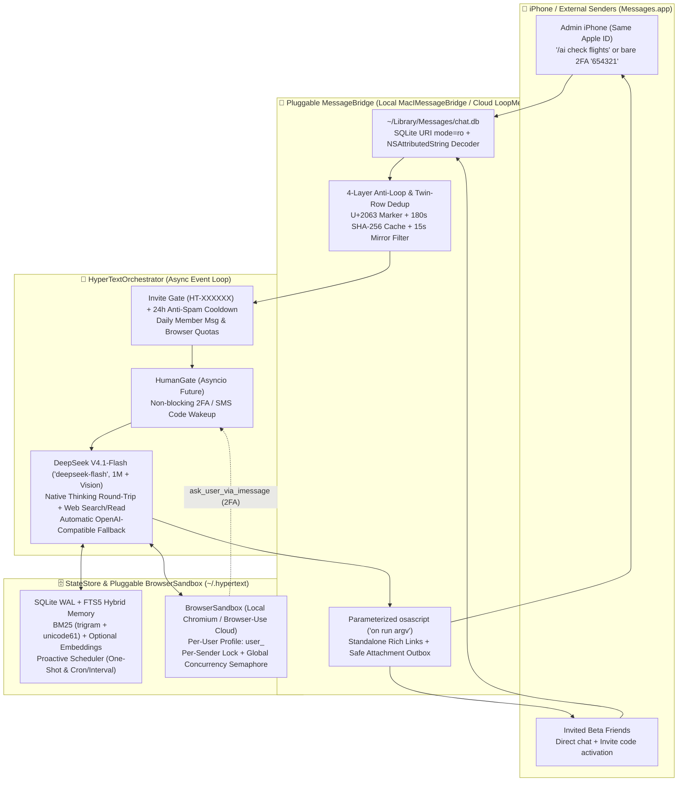

# HyperText (`plotloop-hypertext`)

> *Your Ambient, Async AI Personal Agent over Apple Messages (iMessage) — Local-First on Mac mini, Zero BlueBubbles Required.*

**English** | [简体中文](./README_CN.md)

[](./pyproject.toml)
[](https://www.python.org/)
[](./LICENSE)
[](./.github/workflows/ci.yml)
[](https://platform.deepseek.com/)
[](https://github.com/browser-use/browser-use)

Turn an always-on **Mac mini** into a native **iMessage Multimodal AI Personal Agent** with persistent hybrid memory, stage-aware async progress, proactive scheduling, **Same-Apple-ID iPhone Self-Chat**, **Multi-User Invite Beta & Per-User Chromium Sandboxes**, and **Human-in-the-Loop 2FA** browser automation.

Zero third-party iPhone app or BlueBubbles relay required — chat directly from Apple `Messages.app` using text, photos (`.heic`/`.jpg`/`.png`), and mobile-ready PDF/HTML deliverables.

---

## Architecture

`HyperText` is engineered around a pluggable **`MessageBridge`** & **`BrowserSandbox`** boundary, supporting both **Local-First Mac mini self-hosting** today and seamless **Cloud Gateway (`LoopMessage` + `Browser-Use Cloud`)** deployment on the roadmap.



---

## Core Highlights

- **Native macOS iMessage Bridge (Zero BlueBubbles Required)**: Strictly read-only `file:.../chat.db?mode=ro` polling, pure-Python `typedstream` / `NSAttributedString` binary decoder (`<0x80`, `0x81`, `0x82`, `0x83` length headers + `U+FFFC` stripping), automatic `.heic`/`.heif` -> JPEG conversion via `/usr/bin/sips`, and injection-proof `on run argv` AppleScript delivery.
- **Ambient Single-Exit Quiet-Tool UX (`v0.5.1`)**: Zero-Markdown human SMS formatting, standalone Rich Link bubble splitting, 3-mode XSS-safe HTML/PDF attachment rendering, and calm, non-intrusive async execution governed by four conversational principles:
  1. **Single-Exit Principle**: Underlying tools (`BrowserSandbox`, web search, document builder) run silently as Quiet Tools — zero unprompted step or domain progress spam from inside tools.
  2. **Zero Plumbing on Screen**: Intermediate `tool_calls` thoughts, step numbers, visited domains, and internal stage names stay in memory (`turn_ctx`) and logs only, never leaking to your phone.
  3. **One Ack + Capped Low-Frequency Reassurance**: Tasks exceeding `FAST_ACK_DELAY_SEC` send **1** natural acknowledgment, then wait a full `HYPERTEXT_HEARTBEAT_INTERVAL_SEC` (`60s` after the ack) to send at most `HYPERTEXT_MAX_HEARTBEAT_PER_TURN` (`1`) calm reassurance before delivering the final answer.
  4. **On-Demand Introspection & Blocking Escalation**: Detailed progress is surfaced only when you ask (`进度` / `到哪了` / `status`, plus instant cancellation via `停`), or when a real human decision/2FA code is required via `HumanGate`.
- **Same-Apple-ID Self-Chat**: Use a single Apple ID across your iPhone and Mac mini (unified across phone number & iCloud email aliases) without infinite reply loops or duplicate replies, powered by a **4-Layer Anti-Loop Engine** and **bare 2FA code bypass**.
- **Multi-User Invite Beta & Per-User Isolation**: Share your Mac mini agent safely with friends or teammates via self-service invite codes (`HT-XXXXXX`), isolated per-user SQLite memories, isolated per-user Chromium profiles (`user_<sha256[:16]>`), bounded concurrency (`BROWSER_MAX_CONCURRENCY`), 24h anti-spam cooldown, and daily usage quotas.
- **DeepSeek V4.1-Flash Native Engine + OpenAI Fallback**: Full `deepseek-flash` (1M context + multimodal vision) support with multi-turn `reasoning_content` & `server_tool_calls` round-trip persistence, native `deepseek_web_search` / `deepseek_read_url` server tools, automatic crashed tool-call history healing, and strict isolation when falling back to OpenAI-compatible endpoints.
- **Browser-Use 1.0 + Non-Blocking 2FA (`HumanGate`)**: Navigates real websites inside persistent local Chromium profiles. When a site asks for an SMS/email verification code, the browser coroutine suspends on an `asyncio.Future`, texts you via iMessage, and resumes the live page the moment you reply.
- **Hybrid Long-Term Memory & Proactive Wakeups**: SQLite WAL store with dual FTS5 indexes (`unicode61` + CJK `trigram`) fused with optional vector embeddings, plus persistent `direct_notify` and `agent_wakeup` scheduled tasks.
- **Explicit-Only Admin `XiaoNa` / `XiaoMiGuan` Workspace Relay (`v0.5.3`, Optional)**: Connect a private `XiaoNa` (`小纳` / `小蜜罐`) HTTP `/ask` relay (e.g. `XIAONA_RELAY_URL=https://xiaona-relay.example.com/ask` + `XIAONA_RELAY_KEY`, `XIAONA_TIMEOUT_SEC=600`) strictly gated to admin handles (`ALLOWED_SENDERS`). Never invoked implicitly — triggers only on explicit address (`/xiaona ...`, `/小纳 ...`, `/小蜜罐 ...`, `/xiaomiguan ...`, `问下小蜜罐...`, `/xiaona reset`), supports zero-restart `.env` / macOS Keychain hot-reload, serializes calls per `conversation_id`, and delivers returned `media_urls` (`<= 25 MB`) as native iMessage attachments with automatic URL fallback.

---

## 5-Minute Quickstart

### Prerequisites
- A Mac (Apple Silicon Mac mini recommended) signed into **Messages.app** with iMessage enabled.
- **Python 3.11+** (`brew install python@3.12`) and Google Chrome / Chromium installed for browser & PDF tasks.
- A **DeepSeek API Key** (`DEEPSEEK_API_KEY`) and/or **OpenAI API Key** (`OPENAI_API_KEY`).

### 1. Install & Initialize

```bash
git clone https://github.com/granken/plotloop-hypertext.git
cd plotloop-hypertext
./scripts/install.sh
```

`install.sh` automatically locates Python 3.11+, creates `.venv`, installs dependencies, generates `.env` (`chmod 600`) from `.env.example`, renders `deploy/com.plotloop.hypertext-agent.local.plist`, and runs `--self-test` + `--doctor`.

### 2. Configure `.env`

```bash
nano .env
```

Set your API key and admin iMessage handle (phone number in E.164 format or Apple ID email):

```ini
PROVIDER_MODE=deepseek
DEEPSEEK_API_KEY=sk-your-real-deepseek-key
DEEPSEEK_MODEL=deepseek-flash

# Admin phone number(s) or Apple ID email(s), comma-separated
ALLOWED_SENDERS=+14155550123,you@icloud.com
```

### 3. Grant macOS Permissions (TCC)

Grant **Full Disk Access** (for read-only `chat.db`) and **Automation -> Messages** (for `osascript` replies) to your terminal / Python binary, then verify:

```bash
./scripts/check_permissions.sh
```

### 4. Test in Interactive CLI or Start Daemon

```bash
# Test memory, tools, and LLM routing locally in terminal
./scripts/start_cli.sh

# Start the live iMessage daemon in foreground
./scripts/start_daemon.sh
```

---

## Same-Apple-ID iPhone Self-Chat Guide

Many users want to message their Mac mini from their own iPhone **without registering a second Apple ID or SIM card**. On macOS, messaging yourself on the same Apple ID creates two classic traps in `chat.db`:
1. Your own message appears as `is_from_me = 1` **and** macOS frequently inserts a mirror `is_from_me = 0` row seconds later.
2. Every AppleScript reply sent back to yourself lands in `chat.db` as both `is_from_me = 1` and `is_from_me = 0`, which would trigger an infinite self-reply loop in naive bots.

Enable Same-Apple-ID Self-Chat in `.env`:

```ini
ALLOWED_SENDERS=+8613800138000,you@icloud.com
ALLOW_SELF_CHAT=true
SELF_CHAT_PREFIX=/ai
```

### How the 4-Layer Anti-Loop Works
1. **Layer 1 — Invisible Outbound Marker & Hash Cache**: Every bot reply is prefixed with zero-width Unicode Invisible Separator `U+2063` (invisible in iOS/macOS Messages UI) and stored in a 180s normalized SHA-256 outbound cache. Any row (`is_from_me=0` or `1`) with `U+2063`, bot status prefixes (`🔐 [`, `🌐 [`, `🖥️ `, `⏰ `, `⚠️ `, `🎉 `, `👋 `), or matching SHA-256 hash is dropped immediately.
2. **Layer 2 — Admin-Only `is_from_me=1` Scope**: `is_from_me=1` rows are inspected **only** when `sender_handle` is in `ALLOWED_SENDERS`. Normal iMessages you send to friends or colleagues are never read or triggered.
3. **Layer 3 — `/ai` Prefix Gate (with Smart 2FA Bypass)**: Prefix self-chat commands with `/ai` (case-insensitive, e.g. `/ai summarize my schedule` or `/ai` + photo) so personal notes sent to yourself (`Buy milk`) stay untouched. **Exception**: When `HumanGate` is waiting for a 2FA verification code, you can reply with the bare code (`654321`) — no `/ai` needed!
4. **Layer 4 — 15s Cross-Alias Twin-Row Mirror Deduplication**: Deduplicates paired `is_from_me=1` + `is_from_me=0` rows across admin phone/email aliases within a 15-second window so every command runs **at most once**.

---

## Multi-User Beta Invite & Per-User Browser Isolation Guide

Want to let trusted friends or beta testers message your Mac mini's iMessage address? Enable invite mode in `.env`:

```ini
ENABLE_INVITE_CODES=true
# Optional static bootstrap codes (max_uses=999, idempotently seeded on startup)
INVITE_CODES=HT-FRIENDS2026
MEMBER_DAILY_MSG_LIMIT=50
MEMBER_DAILY_BROWSER_LIMIT=10
BROWSER_MAX_CONCURRENCY=3
```

### Managing Invites & Beta Users

```bash
# Generate a 1-time random invite code (e.g. HT-7K9P2M)
.venv/bin/python3 hypertext_agent.py --create-invite --invite-note "Alice"

# Generate a custom 5-use code
.venv/bin/python3 hypertext_agent.py --create-invite --invite-code HT-TEAM01 --invite-uses 5 --invite-note "Design team"

# Inspect authorized users, today's quota usage, and invite codes
.venv/bin/python3 hypertext_agent.py --list-users
```

### Multi-User Isolation & Safety Guarantees
- **Direct Chat for External Members**: External invited users (`is_from_me=0`) chat naturally **without** needing the `/ai` prefix, even while `ALLOW_SELF_CHAT=true` is active for the admin's own handle.
- **Self-Service Activation + 24h Anti-Spam Cooldown**: When an unknown sender texts the bot, if their message contains a valid code (`HT-XXXXXX` or `/activate CODE`), they are activated immediately. Otherwise, the bot sends **at most 1** polite invite prompt per 24 hours (`invite_prompt_ts:<sender>`), preventing spam or Apple ID rate-limits.
- **Per-User Browser Sandbox (`user_<sha256[:16]>`)**: Each user gets a completely isolated Chromium directory under `~/.hypertext/browser_profiles/user_<sha256[:16]>/` (zero phone/email PII in folder names) guarded by a per-sender `asyncio.Lock` plus a global `asyncio.Semaphore(BROWSER_MAX_CONCURRENCY)`.
- **Daily Quotas**: Members are capped at `MEMBER_DAILY_MSG_LIMIT` messages/day and `MEMBER_DAILY_BROWSER_LIMIT` browser tasks/day; admins in `ALLOWED_SENDERS` are exempt.

---

## CLI Reference

| Command / Flag | Description |
| :--- | :--- |
| `hypertext` (or `python3 hypertext_agent.py`) | Run the 24x7 iMessage polling & proactive scheduler daemon |
| `hypertext --cli` | Interactive local terminal REPL |
| `hypertext --self-test` | Run all 10 offline subsystem checks (zero API keys / zero network) |
| `hypertext --doctor` | Validate Python, SQLite FTS5, keys, TCC permissions, Self-Chat & Invite config |
| `hypertext --create-invite` | Generate a new beta invite code (`--invite-code`, `--invite-uses`, `--invite-note`) |
| `hypertext --list-users` | Display authorized beta users, today's msg/browser usage, and invite codes |
| `hypertext --allow-user HANDLE` | Hot-whitelist a phone/Apple ID directly in SQLite (`--user-note` optional) |
| `hypertext --revoke-user HANDLE` | Hot-revoke a user's access immediately without restarting the daemon |
| `hypertext --env-file PATH` | Load configuration from a custom `.env` file path |

---

## 24x7 `launchd` Background Service

`./scripts/install.sh` renders `deploy/com.plotloop.hypertext-agent.local.plist` with your machine's paths. To enable auto-start at login and crash recovery:

```bash
cp deploy/com.plotloop.hypertext-agent.local.plist ~/Library/LaunchAgents/com.plotloop.hypertext-agent.plist
launchctl unload ~/Library/LaunchAgents/com.plotloop.hypertext-agent.plist 2>/dev/null || true
launchctl load -w ~/Library/LaunchAgents/com.plotloop.hypertext-agent.plist

# Tail logs
tail -f ~/.hypertext/logs/stdout.log ~/.hypertext/logs/stderr.log
```

---

## Roadmap & Pluggable Cloud Gateway

Because `HyperTextOrchestrator` decouples transport (`MessageBridge` in `hypertext/bridge_imessage.py`) and browser execution (`BrowserSandbox` in `hypertext/sandbox_browser.py`), the same cognitive core scales across two deployment modes:

- **Mode A — Local-First Mac mini Self-Hosting (`v0.5.3`, GA)**: Zero relay servers, read-only local `chat.db` + parameterized `osascript`, local SQLite WAL memory in `~/.hypertext`, and local isolated Chromium profiles.
- **Mode B — Cloud Gateway (`LoopMessage` + `Browser-Use Cloud`, Roadmap)**: Swap in a `LoopMessage` webhook/REST `MessageBridge` and remote `Browser-Use Cloud` sessions to host multi-tenant iMessage agents on Linux/cloud infrastructure without local Mac hardware, while preserving `HumanGate` 2FA wakeup, hybrid memory, and per-sender isolation.
- **Additional Channels**: Connect **Feishu / Lark, Telegram, BlueBubbles, or Sendblue** by implementing the 2-method `MessageBridge` interface. See [CONTRIBUTING.md](./CONTRIBUTING.md) for a complete adapter template.

---

## Trademark & Safety Disclaimer

- **Independent Open-Source Project**: `plotloop-hypertext` (**HyperText**) is an independent, community-built open-source engineering project exploring local-first and cloud-ready personal AI agents. It is **not** affiliated with, endorsed by, or sponsored by Apple Inc., DeepSeek, OpenAI, or any other third party. Apple, macOS, iPhone, and iMessage are trademarks of Apple Inc.
- **Safe & Responsible Use**: In Local-First mode, this software reads your local `~/Library/Messages/chat.db` in strictly read-only mode (`mode=ro`) and sends replies through official macOS AppleEvents (`osascript`) on hardware you own and control. Do **not** use this software for unsolicited bulk messaging, commercial spam, or scraping restricted websites. Users are solely responsible for complying with Apple's Terms of Service, website terms, and applicable laws.
- **Financial & Account Safety**: Never instruct an autonomous browser agent to execute unsupervised financial transfers. Review [SECURITY.md](./SECURITY.md) before exposing multi-user beta access.
