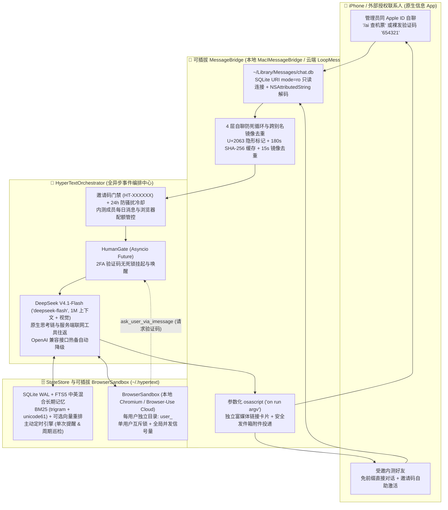

# HyperText（超文本 · `plotloop-hypertext`）

> *HyperText（超文本 · `plotloop-hypertext`）—— 活在苹果「信息（iMessage）」里的无感异步私人助理（Mac mini 本地优先 · 免装 BlueBubbles · 零隐私泄露）*

[English](./README.md) | **简体中文**

[](./pyproject.toml)
[](https://www.python.org/)
[](./LICENSE)
[](./.github/workflows/ci.yml)
[](https://platform.deepseek.com/)
[](https://github.com/browser-use/browser-use)

将一台常驻开机的 **Mac mini** 打造为原生的 **iMessage 多模态异步私人助理** —— 内置混合长期记忆、双速秒回与阶段感知进度、主动定时唤醒、**同 Apple ID 手机自聊防死循环**、**多用户邀请码内测与独立浏览器沙箱隔离**，以及支持 **iMessage 实时回传验证码（2FA）** 的真实浏览器自动化能力。

iPhone 端免装任何第三方 App，Mac 端无需折腾 BlueBubbles 中转 —— 直接在苹果原生「信息（Messages）」中发送文字、照片（支持 `.heic` 实况图自动转码），即可随时交代任务并接收手机端自适应 PDF/HTML 卡片附件。

---

## 系统架构图

`HyperText` 采用可插拔的 **`MessageBridge`（消息桥接层）** 与 **`BrowserSandbox`（浏览器沙箱层）** 解耦架构，既原生支持 **Mac mini 本地优先自托管（Local-First）**，也为未来的 **云端网关架构（`LoopMessage` + `Browser-Use Cloud`）** 做好了无缝演进准备。



---

## 核心特性

- **macOS 原生 iMessage 安全桥接（免装 BlueBubbles）**：强制通过 `file:.../chat.db?mode=ro` 只读模式轮询，内置纯 Python `typedstream` / `NSAttributedString` 二进制解码器（完整覆盖 `<0x80`、`0x81`、`0x82`、`0x83` 变长头与 `U+FFFC` 附件占位符剥离），自动调用 `/usr/bin/sips` 将 iPhone `.heic/.heif` 转为 JPEG，并通过 `on run argv` 参数化 AppleScript 安全回发。
- **无感异步短信交互与「对话及进度播报四原则」（`v0.5.1`）**：内置零 Markdown 纯净排版引擎、末尾参考链接自动拆分为原生富媒体预览卡片、三模式防 XSS 手机端 PDF/HTML 附件渲染，并遵循静默克制的异步对话四原则：
  1. **单一出口原则（Single-Exit）**：所有工具（含 `BrowserSandbox` 浏览器沙箱、联网检索与文档生成）均作为安静底层能力（Quiet Tools）运行，除 2FA/付款确认与交付最终附件外，工具内部零进度刷屏，统一由编排器管控消息出口。
  2. **过程不上屏原则（Zero Plumbing on Screen）**：中间工具轮次伴随的过渡文本、步骤号（`Step N`）、访问域名及工程黑话仅记录于内存态（`turn_ctx`）与日志，绝不直接发往手机干扰用户。
  3. **派活单次回执 + 低频单次兜底**：耗时任务超过 `FAST_ACK_DELAY_SEC` 时仅发 **1 次** 自然接单回执；此后严格以回执发送时刻（`ack_sent_at`）为锚点，满 `HYPERTEXT_HEARTBEAT_INTERVAL_SEC`（默认 `60s`）最多发送 `HYPERTEXT_MAX_HEARTBEAT_PER_TURN`（默认 `1`）次无术语安抚，随后静默直至交付最终结果。
  4. **按需内省与阻塞升级**：仅在用户主动发消息询问（如 `查进度` / `到哪了` / `在干嘛`，或发 `停` 随时中止）时读取内存态礼貌简报，或在遇到验证码/支付拍板等真正阻塞点时通过 `HumanGate` 主动升级求助。
- **同 Apple ID 手机自聊模式**：无需注册第二个 Apple ID 或备用手机卡！支持手机号与 iCloud 邮箱跨别名会话自动归一，配合 **4 层防回环引擎 + 15 秒镜像双行去重 + 2FA 裸验证码免前缀直通**，彻底解决自己给自己发消息时的无限死循环与重复触发问题。
- **多用户邀请码内测与独立沙箱隔离**：支持一键生成邀请码（如 `HT-XXXXXX`）分享给朋友体验；每位用户拥有完全隔离的 SQLite 记忆分区与独立的 Chromium 浏览器 Profile（`user_<sha256[:16]>`，目录名零手机号/邮箱隐私泄露），配合全局并发池上限（`BROWSER_MAX_CONCURRENCY`）、陌生人 24 小时防骚扰冷却与每日配额限制。
- **DeepSeek V4.1-Flash 原生引擎 + OpenAI 自动热备**：默认采用 `deepseek-flash`（1M 超长上下文 + 多模态视觉理解），严格持久化并回传 `reasoning_content` 与 `server_tool_calls`，原生启用 `deepseek_web_search` / `deepseek_read_url`；异常中断的工具调用历史可自动自愈，切换到 OpenAI 兼容模式时自动剥离私有扩展字段。
- **Browser-Use 1.0 真实网页代办 + 2FA 协同解锁**：在独立本地 Chromium 沙箱中执行复杂网页任务；遇到短信/邮箱二次验证时，浏览器协程原地挂起并通过 iMessage 询问你，回复验证码后秒级唤醒继续操作；内置支付/转账红线拦截。
- **SQLite FTS5 中英混合记忆 + 主动定时引擎**：同时维护 `unicode61` 词级索引与 `trigram` 中文子串索引（可选融合 Embedding 向量检索），并提供持久化单次/周期定时提醒与后台 Agent 巡检任务。
- **主理人独享「5 路多智能体协同矩阵 + 竞技场对比」（`v0.6.0`，可选扩展）**：严格绑定 `ALLOWED_SENDERS` 主理人身份门禁（内测成员零子进程/零请求触达，日常对话 0% 隐式误触），仅在显式点名时按需唤醒，并自动将新生成的 HTML/PDF/PPTX/图片等产物（`<= 25 MB`）作为原生 iMessage 附件发回手机：
  - **小纳 / 小蜜罐（`/xiaona`、`/小蜜罐`）**：对接私人工作台 HTTP `/ask` 通道（如 `https://xiaona-relay.example.com/ask`），支持免重启密钥热加载与 `media_urls` 原生附件直传。
  - **WorkBuddy（`/wb`、`/workbuddy`）**：调用本机 `@tencent-ai/codebuddy-code`，支持 `.nvm` 自动发现与 `~/.codebuddy` -> `~/.workbuddy` 双目录自动回退。
  - **DSH（`/dsh`、`让 DSH ...`）**：调用本机 **DeepSeek Harness** 无头模式，自动探测本机 Magpie 网关（`127.0.0.1:3425` `--patch`）并跨轮次续接 `sessionId`。
  - **Codex（`/codex`、`/cdx`）**：调用本机 **OpenAI Codex CLI**（`codex exec` / `codex exec resume`），内置模型自动降级链与 `thread_id` 持久化续聊。
  - **AGY（`/agy`、`/antigravity`）**：调用本机 **Google Antigravity CLI**，强制注入 `NO_PROXY=127.0.0.1,localhost,::1` 守护本机 gRPC 侧车；一句话同时点名多个智能体（如 `让 DSH、Codex 和 AGY 分别给出方案对比`）时自动开启**多智能体竞技场综合研判**。

---

## 5 分钟快速上手

### 环境准备
- 一台已登录 **信息（Messages.app）** 并开启 iMessage 的 Mac（推荐 Apple Silicon Mac mini 常驻运行）。
- **Python 3.11+**（可通过 `brew install python@3.12` 安装）以及本地 Chrome / Chromium 浏览器。
- **DeepSeek API Key**（`DEEPSEEK_API_KEY`）或 **OpenAI API Key**（`OPENAI_API_KEY`）。

### 1. 一键安装与初始化

```bash
git clone https://github.com/granken/plotloop-hypertext.git
cd plotloop-hypertext
./scripts/install.sh
```

`install.sh` 会自动探测 Python 3.11+、创建 `.venv` 虚拟环境、安装依赖、从 `.env.example` 生成权限为 `600` 的 `.env`（若已存在则绝不覆盖）、渲染本机专属的 `deploy/com.plotloop.hypertext-agent.local.plist`，并自动执行 `--self-test` 与 `--doctor`。

### 2. 配置 `.env`

```bash
nano .env
```

填入真实密钥与管理员白名单账号（手机号带国家码如 `+86138...`，或 Apple ID 邮箱）：

```ini
PROVIDER_MODE=deepseek
DEEPSEEK_API_KEY=sk-替换为你的真实DeepSeek密钥
DEEPSEEK_MODEL=deepseek-flash

# 管理员白名单（多个账号用英文逗号分隔）
ALLOWED_SENDERS=+8613800138000,your_apple_id@icloud.com
```

### 3. 授予 macOS 系统权限（TCC）

在「系统设置 -> 隐私与安全性」中为终端（Terminal / iTerm2）及 Python 授予 **完全磁盘访问权限（Full Disk Access）** 与 **自动化（Automation -> Messages）** 权限，然后运行检查脚本：

```bash
./scripts/check_permissions.sh
```

### 4. 启动交互终端或后台守护

```bash
# 本地命令行交互模式（无需通过 iMessage 即可测试记忆与工具链）
./scripts/start_cli.sh

# 前台启动 iMessage 实时监听守护进程
./scripts/start_daemon.sh
```

---

## 同 Apple ID 手机自聊配置指南

如果你希望**手机和 Mac mini 登录同一个 Apple ID**，直接在 iPhone「信息」里发消息给自己来指挥 Mac mini，只需在 `.env` 开启：

```ini
ALLOWED_SENDERS=+8613800138000,your_apple_id@icloud.com
ALLOW_SELF_CHAT=true
SELF_CHAT_PREFIX=/ai
```

### 为什么需要四层防回环保护？
在 macOS 同账号自聊场景下，`chat.db` 存在两个底层特性：
1. 你在 iPhone 发给自己的同一条消息，往往会同时产生一条 `is_from_me = 1` 记录和一条镜像的 `is_from_me = 0` 记录；
2. 助理通过 AppleScript 回复给你的每一条消息，同样会作为新消息写回 `chat.db`（同时带有 `is_from_me = 1` 和 `0`）。

`HyperText` 通过以下 4 层机制确保零死循环、零误触：
1. **第 1 层 — `U+2063` 隐形回声标记 + 180 秒 SHA-256 哈希缓存**：所有助理发出的消息自动前置零宽不可见分隔符 `\u2063`（手机端视觉完全无感）并记录归一化文本哈希；轮询时无论 `is_from_me` 是 `0` 还是 `1`，凡命中 `\u2063`、系统状态前缀（`🔐 [`、`🌐 [`、`🖥️ `、`⏰ `、`⚠️ `、`🎉 `、`👋 `）或 180 秒出站哈希缓存的记录一律丢弃。
2. **第 2 层 — `is_from_me=1` 仅限管理员自聊会话**：只有当会话对象本身属于 `ALLOWED_SENDERS` 时才允许处理 `is_from_me=1`，你平时在手机上发给其他朋友、同事的消息**绝不会**触发 AI。
3. **第 3 层 — `/ai` 唤醒前缀与 2FA 裸验证码智能豁免**：平时给自己发备忘（如 `买牛奶`）不会触发 AI；发送 `/ai 帮我查明天去上海的高铁`（大小写不敏感，或 `/ai` 配图片）才会唤醒助理。**特例豁免**：当浏览器遇到登录验证、正在通过 `HumanGate` 等待你回复验证码时，直接回复纯数字 `654321`（无需加 `/ai`）即可秒级解锁！
4. **第 4 层 — 15 秒跨别名镜像双行去重**：对管理员手机号/邮箱别名统一维护 15 秒去重窗口，确保 macOS 插入的一对镜像行只触发 **1 次** 回复。

---

## 多用户邀请码内测与独立沙箱指南

想把你的 Mac mini 助理安全地开放给几位好友或团队成员内测？在 `.env` 开启：

```ini
ENABLE_INVITE_CODES=true
# 可选静态种子邀请码（启动时幂等写入，默认可重复核销 999 次）
INVITE_CODES=HT-FRIENDS2026
MEMBER_DAILY_MSG_LIMIT=50
MEMBER_DAILY_BROWSER_LIMIT=10
BROWSER_MAX_CONCURRENCY=3
```

### 邀请码与用户管理 CLI

```bash
# 生成一枚单次随机邀请码（格式如 HT-7K9P2M）
.venv/bin/python3 hypertext_agent.py --create-invite --invite-note "发给小王体验"

# 生成自定义可使用 5 次的团队邀请码
.venv/bin/python3 hypertext_agent.py --create-invite --invite-code HT-TEAM01 --invite-uses 5 --invite-note "产品组内测"

# 查看所有已激活内测用户、今日配额消耗及有效邀请码
.venv/bin/python3 hypertext_agent.py --list-users
```

### 多租户安全与防封号设计
- **外部内测好友免前缀畅聊**：已激活的外部联系人（`is_from_me=0`）直接发消息即可对话，无需输入 `/ai` 前缀。
- **自助核销 + 24 小时防骚扰冷却**：未授权陌生人发来包含有效邀请码的消息（如 `HT-XXXXXX` 或 `/activate CODE`）即刻自动开通独立空间；若未携带邀请码，系统在 **24 小时内最多礼貌提示 1 次**（`invite_prompt_ts:<sender>`），既避免死循环互刷，又严格保护你的 Apple ID 信誉。
- **每用户 SHA-256 独立浏览器沙箱**：每位用户的 Chromium 登录态与 Cookie 物理隔离在 `~/.hypertext/browser_profiles/user_<sha256[:16]>/`（文件夹名不含任何明文手机号/邮箱），单用户内部通过独立 `asyncio.Lock` 杜绝 `SingletonLock` 冲突，跨用户通过全局 `asyncio.Semaphore(BROWSER_MAX_CONCURRENCY)` 控制并发上限，保护 Mac mini 内存。
- **每日配额防刷**：普通内测成员受 `MEMBER_DAILY_MSG_LIMIT` 与 `MEMBER_DAILY_BROWSER_LIMIT` 限制；`ALLOWED_SENDERS` 管理员不受配额限制。

---

## CLI 命令速查

| 命令参数 | 功能说明 |
| :--- | :--- |
| `hypertext`（或 `python3 hypertext_agent.py`） | 启动 7x24 小时 iMessage 轮询与主动定时任务守护进程 |
| `hypertext --cli` | 进入本地终端交互式测试模式 |
| `hypertext --self-test` | 离线运行全部 10 项核心子系统自检（零网络依赖、无需 API Key） |
| `hypertext --doctor` | 全面诊断 Python、SQLite FTS5、密钥占位符、TCC 权限与自聊/内测配置 |
| `hypertext --create-invite` | 创建内测邀请码（支持 `--invite-code`、`--invite-uses`、`--invite-note`） |
| `hypertext --list-users` | 查看已授权内测成员列表、今日消息/浏览器已用额度及邀请码状态 |
| `hypertext --allow-user HANDLE` | 免改 `.env`、免重启直接热添加白名单用户（支持 `--user-note`） |
| `hypertext --revoke-user HANDLE` | 免重启立即吊销指定用户的访问权限 |
| `hypertext --env-file PATH` | 指定自定义 `.env` 配置文件路径 |

---

## 配置 `launchd` 开机自启守护服务

运行 `./scripts/install.sh` 后，项目会自动在 `deploy/com.plotloop.hypertext-agent.local.plist` 生成适配当前机器路径的配置：

```bash
cp deploy/com.plotloop.hypertext-agent.local.plist ~/Library/LaunchAgents/com.plotloop.hypertext-agent.plist
launchctl unload ~/Library/LaunchAgents/com.plotloop.hypertext-agent.plist 2>/dev/null || true
launchctl load -w ~/Library/LaunchAgents/com.plotloop.hypertext-agent.plist

# 查看实时运行日志
tail -f ~/.hypertext/logs/stdout.log ~/.hypertext/logs/stderr.log
```

---

## 演进路线图与可插拔云端网关（Roadmap）

依托 `HyperTextOrchestrator` 对通信传输层（`MessageBridge`）与浏览器执行层（`BrowserSandbox`）的彻底解耦，同一套核心编排引擎可无缝覆盖两种部署形态：

- **形态 A — Mac mini 本地优先自托管（`v0.6.0`，当前已就绪）**：零第三方中转服务器，本地只读 `chat.db` + 参数化 `osascript` 直连原生 iMessage，记忆与 Chromium 登录态 100% 留在 `~/.hypertext`。
- **形态 B — 云端无硬件网关（`LoopMessage` + `Browser-Use Cloud`，演进路线图）**：通过对接 `LoopMessage` 云端 iMessage 网关适配器与 `Browser-Use Cloud` 托管浏览器集群，即可在纯 Linux 云服务器上弹性部署多租户 iMessage 私人助理，并完整保留 `HumanGate` 2FA 验证码协同、混合记忆与租户级隔离能力。
- **更多消息渠道扩展**：只需实现 `MessageBridge` 的两个方法（`poll_new_messages` 与 `send_text`），即可快速接入飞书长连接机器人、Telegram、BlueBubbles 或 Sendblue。详见 [CONTRIBUTING.md](./CONTRIBUTING.md)。

---

## 商标与安全免责声明

- **独立开源项目声明**：`plotloop-hypertext`（**HyperText**）是由社区独立研发的本地优先（Local-First）与云原生可扩展个人 AI 助理开源工程实践，与 Apple Inc.、DeepSeek、OpenAI 或任何第三方公司不存在隶属、背书或赞助关系。Apple、macOS、iPhone 与 iMessage 均为 Apple Inc. 的注册商标。
- **合规与防滥用声明**：在本地优先模式下，本项目仅在你本人拥有控制权的 Mac 设备上以严格只读方式（`mode=ro`）读取本地 `chat.db`，并通过系统标准 AppleEvents（`osascript`）回发个人助理消息。严禁将本项目用于批量群发营销信息、垃圾消息或违规抓取受保护网站；使用者须自行遵守 Apple 服务条款、目标网站协议及所在地法律法规。
- **资金与账号安全**：请勿授权自动化浏览器无人值守执行资金转账或密码修改操作。开启多用户内测前请仔细阅读 [SECURITY.md](./SECURITY.md)。
